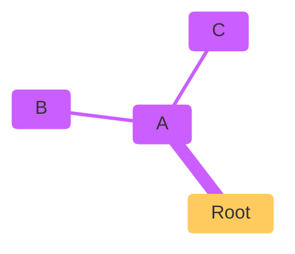

<figure>

<figcaption>
Diagram. View diagram code on <a href="https://mermaid.live/edit#pako:sUpErLoNgEnCoDeDsTrInG">mermaid.live</a>.
</figcaption>
</figure>

<!--typst-begin-exclude-->

<!--typst-end-exclude-->
